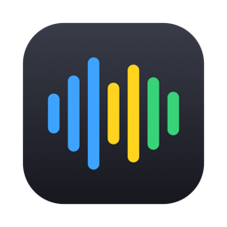
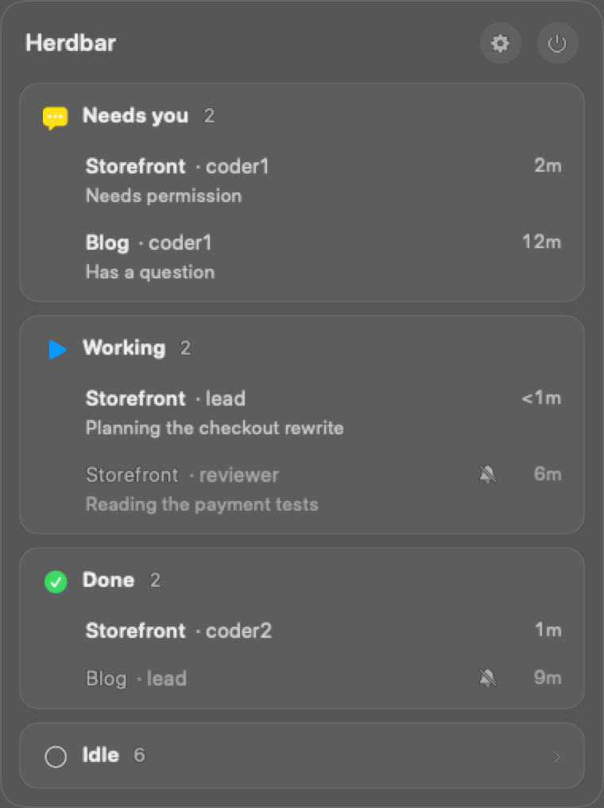
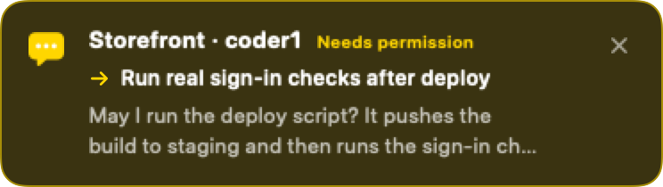
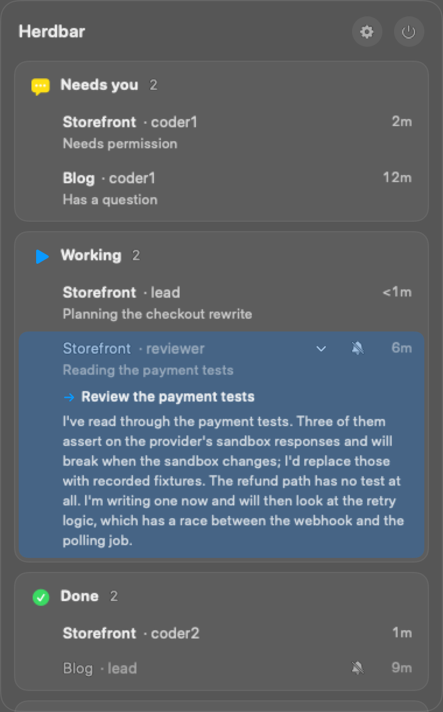
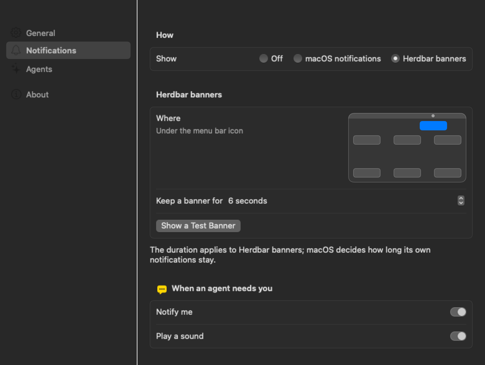
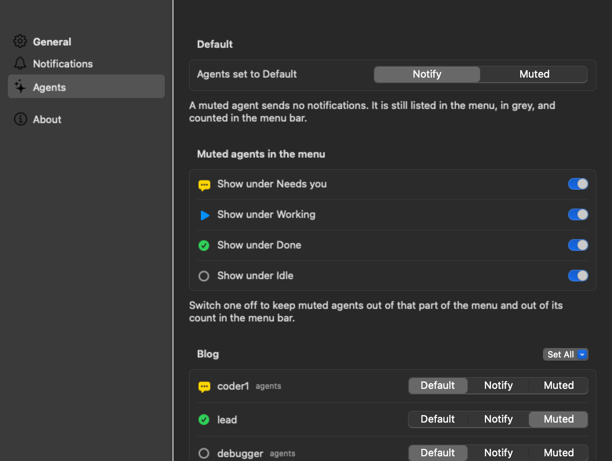

<p align="center">
  
</p>

<h1 align="center">Herdbar</h1>

<p align="center">
  Your <a href="https://herdr.dev">Herdr</a> agents in the Mac's menu bar:<br>
  who is working, who needs you, and who has finished.
</p>

<p align="center">
  
</p>

When several coding agents run at once, the one that matters is the one waiting for you.
Herdbar keeps three numbers in the menu bar, tells you when an agent asks a question or
finishes, and takes you to it in Herdr with a click or a shortcut.

<p align="center">
  
</p>

Version 0.1.2. A personal tool, not affiliated with or endorsed by Herdr. Herdbar only
reads from Herdr; it never sends anything to an agent.

## What it does

| A notification | A row opened out |
| --- | --- |
|  |  |

- **Counts in the menu bar:** working (blue), needs you (yellow), done (green). The idle
  count can be added.
- **A menu grouped by state:** Needs you, Working, Done, Idle; in each, the most recent
  change first. "Done" means finished and not yet looked at in Herdr, as in Herdr's own list.
- **Notifications** when an agent starts needing you or finishes, as Herdbar's own banners
  or as macOS notifications. Each carries Claude's title for the session and the start of
  the agent's last message. Banners have a set duration and position, and each kind of
  notification can play a sound.
- **Jump to the agent:** a click on a row or a banner brings Herdr to the front and
  switches to the agent's space and tab. A system-wide shortcut does the same for the most
  recent notification, even after its banner has gone.
- **Mute per agent:** Default, Notify or Muted, with an app-wide choice for Default. A
  muted agent sends no notifications. It stays in the menu, in grey, unless you keep muted
  agents out of that part of the menu; then it is not counted either.
- **Dismiss:** move an agent to Idle until its state next changes. One at a time, all Done
  at once, or, for Done agents, when you open one in Herdr or after a set time.

The screenshots show invented agents.

## Requirements

- macOS 15 or later.
- The [Herdr](https://herdr.dev) desktop app, with its `herdr-core` command at
  `~/.local/bin/herdr-core`.
- Agents that are Claude Code sessions. Others are not shown.
- Xcode, for its Swift toolchain. There is no download; you build it yourself.

## Install

```sh
git clone https://github.com/akiarostami/herdbar.git
cd herdbar
./scripts/build-app.sh
open ~/Applications/Herdbar.app
```

The script builds a release, assembles `~/Applications/Herdbar.app` and signs it. Herdbar
has no Dock icon; look for the three counts in the menu bar.

To let Herdbar switch Herdr to an agent's space and tab, give it the Accessibility
permission: **Settings → General** in Herdbar has a button that opens the right page of
System Settings. Without it, a click still brings Herdr to the front.

## Settings

<p align="center">
  
</p>

| Page | Holds |
| --- | --- |
| General | Launch at login, the two shortcuts, idle agents, dismissing, and opening an agent in Herdr. |
| Notifications | Off, macOS notifications or Herdbar banners; where a banner appears and for how long; whether to notify and play a sound for each kind. |
| Agents | The Default rule, whether muted agents are listed under each state, and Default, Notify or Muted for each agent. |

<p align="center">
  
</p>

## Keyboard

Set a system-wide shortcut under **Settings → General** to open the menu from any app, and
a second one to open the agent of the most recent notification. With the menu open:

| Key | Action |
| --- | --- |
| ↑ ↓ | Move between agents |
| Return or Space | Open the selected agent in Herdr |
| → / ← | Open out / close the selected row: full status and last message |
| M | Mute or unmute the selected agent |
| . or Delete | Dismiss the selected agent |
| ⇧. | Dismiss all Done agents |
| ⌘Z | Undo the last dismissal |
| ⌘, | Settings |
| ⌘Q | Quit |
| Esc | Close the menu |

## How it works

- Herdbar runs one command, `~/.local/bin/herdr-core events --json`, and follows what it
  prints: a snapshot of the agents, then each change of status.
- The session title and the last message come from the end of the agent's Claude Code
  transcript in `~/.claude/projects`. Herdbar reads only the tail of the file.
- To go to an agent, Herdbar brings Herdr to the front and presses Herdr's own shortcuts:
  Control-1 to 9 for the space, Command-1 to 9 for the tab.

## Privacy

- Herdbar makes no network calls.
- It reads Herdr's event stream, Herdr's layout file and Claude Code transcripts on your Mac, and writes only
  its own settings (macOS defaults, `com.minorkey.herdbar`).

## Signing

The build script signs with the first code-signing certificate in your Keychain, or the one
named in `HERDBAR_SIGN_IDENTITY`. With none it signs ad hoc: the app runs, but its
signature changes with every build, so macOS asks for the Accessibility permission again
after a rebuild. A free **Apple Development** certificate, created in Xcode under
Settings → Accounts → Manage Certificates, avoids that.

## Development

```sh
swift test                 # the logic tests
./scripts/build-app.sh     # build, sign and install
./scripts/make-icon.sh     # regenerate Resources/AppIcon.icns after changing the mark
```

| Path | Holds |
| --- | --- |
| `Sources/HerdbarCore/` | Logic with no interface: agents and their states, Herdr's event feed and layout, transcripts. |
| `Sources/Herdbar/` | The app: `AppModel`, the menu panel, banners, settings, shortcuts. |
| `Tests/` | Tests of the logic. |

Two environment variables help when working on the interface:

- `HERDBAR_DEMO=1` starts the app with invented agents and the default settings. It does
  not talk to Herdr and saves nothing.
- `HERDBAR_SNAPSHOT_DIR=<folder>` makes the app open its menu and settings pages in turn
  and save a PNG of each. The screenshots in this README were made with both:

  ```sh
  open --env HERDBAR_DEMO=1 --env HERDBAR_SNAPSHOT_DIR=/tmp/shots ~/Applications/Herdbar.app
  ```

## Limits

- Claude Code agents in Herdr only.
- A click lands on the agent's tab, not on its pane among several in that tab.
- Only the first nine spaces and the first nine tabs can be reached, and only if Herdr's
  shortcuts for them have not been changed.
- Dismissals are forgotten when Herdbar restarts.

## Licence

MIT. See [LICENSE](LICENSE).
